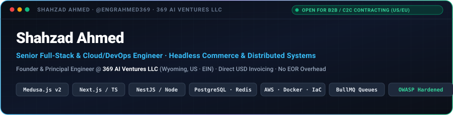
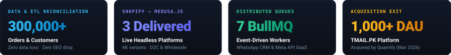

<div align="center">

<picture>
  <source media="(prefers-color-scheme: dark)" srcset="assets/hero-dark.svg">
  <source media="(prefers-color-scheme: light)" srcset="assets/hero-light.svg">
  
</picture>

<br/>

[](https://369aiventures.com)
[](https://linkedin.com/in/engr-ahmed-216994391)
[](https://youtu.be/e9KqTkcbuVc)
[_588--6495-25D366?style=for-the-badge&logo=whatsapp&logoColor=white)](https://wa.me/13155886495)
[](mailto:imshahzadahmed3@gmail.com)

</div>

<br/>

<picture>
  <source media="(prefers-color-scheme: dark)" srcset="assets/metrics-dark.svg">
  <source media="(prefers-color-scheme: light)" srcset="assets/metrics-light.svg">
  
</picture>

<br/>

## 🏛️ Executive Summary

I am a **Senior Full-Stack & Cloud/DevOps Engineer** and the founder of **369 AI Ventures LLC** (Wyoming, USA). I architect, deploy, and maintain mission-critical distributed systems, high-concurrency headless commerce backends, and multi-tenant SaaS platforms for clients across the US, UK, and EU.

My core specialty is **decoupling legacy monoliths into high-velocity headless architectures** (e.g., Shopify to Medusa.js v2), building **resilient event-driven background job pipelines** (BullMQ / Redis / Celery), and implementing **zero-trust cloud infrastructure** on AWS, DigitalOcean, and Cloudflare.

- **Entity & Legal:** Founder & Principal Engineer, **369 AI Ventures LLC** (Wyoming, US — EIN registered).
- **Engagement Flexibility:** Direct B2B / C2C Contracting · Standard US MSAs & NDAs · Clean USD Invoicing.
- **Zero Overhead:** No Employer of Record (EOR) markup · No US visa sponsorship or relocation required.
- **Availability & Timezone:** Based in Islamabad, Pakistan (`UTC+5`) with **4–6 hours daily overlap** with US Eastern, US Pacific, UK, and European business hours.

---

## 🚀 Verified Production Architectures

### 01. High-Scale US Headless Commerce Migrations · Shopify → Medusa.js v2
*Delivered: July – November 2026 · Role: Lead Architect & 3-Developer Team Lead*

Delivered **3 live, enterprise-grade Shopify to Medusa.js migrations** for high-volume US commercial brands with zero data loss and zero search engine authority drop:
- **Flagship D2C Store:** Migrated **300,000+ historical orders and customer records**, preserving historical customer lookups via passwordless authentication.
- **Multi-Brand Retail Storefront:** Deployed a **600-product** high-concurrency catalog with Redis-backed faceted search.
- **High-SKU Wholesale Platform:** Migrated a **6,000-variant / 2,000-product** wholesale catalog with B2B tier pricing.
- **Zero-Downtime ETL & Verification:** Built streaming JSONL extract-transform-load (ETL) pipelines with automated two-gate count and financial reconciliation, achieving **100% data integrity** and **0% SEO URL loss** via verbatim handle preservation and automated 308 redirect mapping.
- **Custom Medusa.js Modules:** Built proprietary Medusa admin extensions including a Bulk Product Editor, Blog Builder, Dynamic Page Builder, and Domain Routing Manager.
- **Third-Party Enterprise Integrations:** Integrated AgeChecker.net identity gating, ShipStation fulfillment, Authorize.net tokenized PCI checkout, Avalara AvaTax, Klaviyo, Resend, Sentry, and Chatwoot.
- **Automated Pricing Worker:** Engineered a Terraform-provisioned AWS EC2 Python pipeline for automated periodic pricing calculation and margin synchronization.
- **Production Infrastructure:** Containerized with Docker and orchestrated via Coolify on DigitalOcean and Medusa Cloud.

---

### 02. Unified Multi-Channel E-Commerce, Mobile & POS Platform · `zamelect.ae`
*Location: Dubai, UAE · Role: Lead Full-Stack & Cloud Architect*

Architected and deployed an end-to-end retail and wholesale commerce ecosystem unifying web, native mobile apps, and retail point-of-sale:
- **Single-Source Backend:** Built on Node.js/TypeScript and PostgreSQL, serving the web storefront, React Native / Expo mobile apps (iOS & Android), and in-store POS terminals from a unified data layer.
- **Distributed Async Pipeline:** Offloaded inventory sync, transactional notifications, and invoice generation to Redis and BullMQ queues to prevent cart contention.
- **AWS Cloud Architecture:** Deployed on Amazon EC2 with managed PostgreSQL, Amazon S3 for media storage, and Cloudflare CDN caching for regional low-latency delivery.
- **Security Hardening:** Conducted rigorous OWASP-aligned API assessments, enforcing granular rate limiting, secure cookie sessions, and payload sanitization.

---

### 03. High-Throughput WhatsApp CRM & Automation SaaS · `BlueTickAPI`
*Location: Dubai, UAE · Role: Principal Backend & Systems Engineer*

Engineered the core distributed messaging and customer relationship management engine connecting enterprise clients to the Meta Cloud API and Baileys protocol:
- **Monorepo Architecture:** Built a high-velocity Node.js and TypeScript monorepo with MongoDB, Redis, and Express.
- **7-Queue Concurrency Pipeline:** Designed **7 isolated BullMQ queues** handling message ingestion, webhook dispatch, template reconciliation, delivery receipts, rate-limit backoff, media transcoding, and CRM state persistence.
- **Production Infrastructure:** Self-hosted on Ubuntu Linux, Nginx reverse proxy, PM2 process management, automated SSL termination, and Cloudflare edge firewall filtering.

---

### 04. Enterprise Multi-Tenant AI Lead Management SaaS · United States
*Role: Lead Systems Architect · Architecture: RFC-Driven Monorepo*

Engineered an enterprise lead orchestration engine with end-to-end multi-tenant isolation and desktop capabilities:
- **RFC-Driven Turborepo:** Next.js 14 App Router frontend, NestJS enterprise REST/GraphQL backend, and FastAPI Python async processing workers in a shared monorepo.
- **Data Isolation & Row-Level Security:** PostgreSQL managed via Prisma ORM combined with Supabase Row-Level Security (RLS) guaranteeing strict tenant data tenancy.
- **Cross-Platform Desktop Shell:** Wrapped core operator interfaces into a lightweight, memory-efficient Tauri desktop shell for enterprise tele-representatives.
- **Distributed Event Bus:** Upstash Redis with BullMQ workers managing background AI transcript enrichment and multi-channel notification dispatch.

---

### 05. Ultra-Low-Latency Disposable Email SaaS · `TMAIL.PK`
*Role: Solo Founder & Architect · Outcome: Acquired by Quamify (March 2026)*

Engineered a serverless, disposable email platform engineered for instant inbox provisioning and sub-second message ingestion:
- **Edge Architecture:** Built on Cloudflare Workers and Vercel Edge Runtime, routing incoming SMTP streams into transient in-memory caches.
- **Scale & Exit:** Scaled organically to **1,000+ daily active users** with 99.99% uptime prior to acquisition by Quamify in March 2026.

---

### 06. Application Security Auditing & DAST Hardening · US Clients
*Role: Security & Infrastructure Consultant*

Conducted comprehensive white-box and black-box security audits across client REST APIs, webhooks, and WebSocket infrastructures:
- **Vulnerability Remediation:** Resolved OWASP Top 10 vulnerabilities including IDOR, broken object level authorization (BOLA), SSRF, and CSRF token bypasses.
- **Automated DAST:** Implemented automated OWASP ZAP dynamic application security testing into GitHub Actions CI pipelines.
- **Edge Hardening:** Configured IP reputation gating, JWT algorithm validation, cryptographic webhook signature verification, and fail-closed rate-limiting under high-traffic DDoS conditions.

---

### 07. R&D & Core Tooling at 369 AI Ventures LLC
*Role: Founder & Principal Engineer*

Driving continuous R&D on fault-tolerant architecture accelerators and autonomous engineering pipelines:
- **Headless Commerce Accelerators:** Reusable Medusa.js v2 starter modules with automated migration runners, schema reconciliation, and pre-integrated US tax/shipping adapters.
- **Agentic Engineering Workflows:** Standardized AI-assisted code review pipelines, RFC verification scripts, and automated proof-of-concept security validation tools.

---

## 🛠️ Technical Core Competencies

<table>
  <tr>
    <td width="20%" valign="top"><strong>Headless Commerce &amp; Monorepos</strong></td>
    <td width="80%">
      <code>Medusa.js v2</code> &middot; <code>Shopify Storefront API</code> &middot; <code>Turborepo</code> &middot; <code>Next.js 14/15</code> &middot; <code>React 18/19</code> &middot; <code>TypeScript</code> &middot; <code>TailwindCSS</code> &middot; <code>TanStack Query</code> &middot; <code>Zustand</code>
    </td>
  </tr>
  <tr>
    <td width="20%" valign="top"><strong>Backend &amp; Distributed Systems</strong></td>
    <td width="80%">
      <code>Node.js</code> &middot; <code>NestJS</code> &middot; <code>Express</code> &middot; <code>FastAPI (Python)</code> &middot; <code>PostgreSQL</code> &middot; <code>Prisma</code> &middot; <code>Drizzle ORM</code> &middot; <code>MongoDB</code> &middot; <code>Redis</code> &middot; <code>BullMQ (7-Queue Architectures)</code>
    </td>
  </tr>
  <tr>
    <td width="20%" valign="top"><strong>Cloud Infrastructure &amp; DevOps</strong></td>
    <td width="80%">
      <code>Amazon Web Services (AWS)</code> &middot; <code>EC2</code> &middot; <code>S3</code> &middot; <code>RDS</code> &middot; <code>DigitalOcean</code> &middot; <code>Cloudflare Workers &amp; Pages</code> &middot; <code>Docker &amp; Compose</code> &middot; <code>Coolify</code> &middot; <code>Terraform</code> &middot; <code>Nginx</code> &middot; <code>GitHub Actions CI/CD</code>
    </td>
  </tr>
  <tr>
    <td width="20%" valign="top"><strong>Security, Payments &amp; Integrations</strong></td>
    <td width="80%">
      <code>OWASP Top 10 / ZAP DAST</code> &middot; <code>Authorize.net PCI Tokenization</code> &middot; <code>Stripe</code> &middot; <code>Avalara AvaTax</code> &middot; <code>ShipStation</code> &middot; <code>Meta Cloud API</code> &middot; <code>Klaviyo</code> &middot; <code>Resend</code> &middot; <code>Sentry</code>
    </td>
  </tr>
  <tr>
    <td width="20%" valign="top"><strong>Mobile &amp; Desktop</strong></td>
    <td width="80%">
      <code>React Native</code> &middot; <code>Expo</code> &middot; <code>Tauri (Rust / Web Shell)</code>
    </td>
  </tr>
</table>

---

## 💼 Direct Contracting & Entity Details

```yaml
Entity: 369 AI Ventures LLC
Jurisdiction: Wyoming, United States (EIN Registered)
Contracting Types: B2B Independent Contractor · C2C · Dedicated Retainer
Invoicing & Currency: Direct Bank Transfer (ACH / Wire) · Invoiced in USD ($)
Legal Framework: US Standard Master Services Agreements (MSAs) & Mutual NDAs
Overhead: Zero Employer of Record (EOR) Fees · No US Visa Sponsorship Required
Working Hours: 4–6 Hours Daily Overlap with US Eastern (ET), US Pacific (PT), UK, and EU
Primary Languages: English (Fluent Professional) · Urdu (Native)
```

---

## 📬 Direct Contact & Verified Channels

If you are an engineering executive, CTO, or founder looking to migrate off a proprietary SaaS monolith, build a high-performance headless commerce stack, or audit and scale your distributed cloud infrastructure:

<div align="left">

- **🌐 Live Production Portfolio:** [369aiventures.com](https://369aiventures.com)
- **💼 LinkedIn:** [linkedin.com/in/engr-ahmed-216994391](https://linkedin.com/in/engr-ahmed-216994391)
- **📹 Video Architecture Walkthrough:** [YouTube: System Architecture Overview](https://youtu.be/e9KqTkcbuVc)
- **💬 WhatsApp Direct:** [+1 (315) 588-6495](https://wa.me/13155886495)
- **📧 Email:** [imshahzadahmed3@gmail.com](mailto:imshahzadahmed3@gmail.com)

</div>

<br/>

<div align="center">
  <sub>© 369 AI Ventures LLC · Built with custom vector architecture · All rights reserved</sub>
</div>
